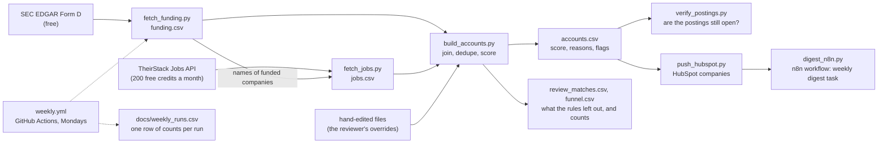

# Signal Pipeline

A weekly pipeline that tells a recruiting platform which SF Bay Area AI startups to contact now, and why. It joins hiring and funding signals, scores each account with its reasons, and syncs the list to HubSpot, on free API tiers.

Every uncertain match is decided by a written rule that flags its own doubt, so no run waits for a person.

The worked example is a platform such as [Brix](https://www.joinbrix.com), which places forward deployed and applied AI engineers. Its best prospects are companies that are hiring those roles this week.

**If you do not read code**, start with the results table below, the [weekly runs](docs/weekly_runs.csv) (one row of counts per run), the [sample output](docs/sample_output/) and the [decisions and their trade-offs](DECISIONS.md).

## Results

Measured on 2026-11-16 to 2026-11-18. Every number comes from a real run.

| Step | Result |
|---|---|
| Funding: SEC Form D notices by California issuers, last 90 days | 1,364 new notices (651 amendments skipped) |
| ...with a Bay Area ZIP code and an industry that is not a fund or property | 251 filings from 231 companies |
| ...inside the amount rule ($100,000 to under $200 million sold) | 197 filings from 184 companies |
| Hiring: Bay Area companies with a forward deployed or applied AI engineer opening, last 14 days | 72 companies beyond the 14 already found (108 postings) |
| Job records fetched | 60, which are 54 distinct postings at 40 companies |
| Dropped by the rules | 3 companies with no usable Form D filing and no core role |
| On the reviewer's block list | 3: two competitors (a firm that sells engineering teams and an AI headhunter) and a fertility clinic |
| Waiting for a person | 0: rules decide every uncertain match; 8 accounts carry a flag |
| **Accounts** | **34**: 8 funded and hiring, 26 hiring only; 23 have a forward deployed opening |
| Open roles behind the list | 45 postings, 25 of them forward deployed; 28 show a salary, with a median midpoint of $195,000. One posting was fetched per new company, so this is a lower bound |
| Are those postings still open? (2026-11-18) | 18 of the 45 are on a job board with a public endpoint, at 10 accounts: 16 open, 1 reposted under a new link, 1 closed. The other 27 are on LinkedIn or another site and are not checked |
| HubSpot (2026-11-17 and 2026-11-18) | first test: 5 companies created. Full list: 29 created and 5 updated; a second run created none and updated 34 |
| Digest in n8n (2026-11-18 UTC) | first run: the workflow found the 5 new companies and created 1 HubSpot task, in 9 seconds. After the full push: 35 new accounts, 8 flagged, 1 task |
| Weekly workflow on GitHub, first run (2026-11-18 UTC, started by hand, capped at 1 + 1 credits) | every step passed in about 13.5 minutes: 1,347 filings read, 2 credits spent, 2 accounts, 1 company created and 1 updated in HubSpot, 1 digest task. Every run since: [docs/weekly_runs.csv](docs/weekly_runs.csv) |
| Contact coverage through Hunter, all 34 accounts (2026-11-18 UTC) | an email for 28 (82%): the target role for 15 (44%), the right team but not its lead for 5, another role for 8. Nothing for 6: Hunter holds no address for those domains. By Hunter's own check, 25 of the 28 emails are valid, 2 accept-all, 1 not rated. One source only |
| Apollo draft sequence (2026-11-18 UTC) | 1 inactive sequence created through the API on the free plan: 3 steps, every email waiting for review. No contact added, nothing sent |
| Cost | $0: 62 of TheirStack's 200 free monthly credits and 31 of Hunter's 50; SEC and the job boards are free |
| Offline checks | 614, in 11 files, on simulated data. 164 planted bugs, each one caught by a check |

The first version listed 5 companies. It required a Form D filing, and only 9 of the 184 funded companies (5%) had a matching job. A backtest explained why: of 5 AI startups that Brix names as customers, only one had filed a Form D under its own name since 2023. Funding now adds points instead of deciding who is listed, and the list grew to 28, with 7 more companies waiting for review.

A reviewer first decided those cases one by one. On 2026-11-17 rules replaced that step, so the weekly run no longer waits for anyone, and the list is now 34. Replayed with no hand decisions, the rules reproduce 6 of the reviewer's 9 decisions: two competitors and a fertility clinic are caught only by the block list, and one staffing firm that the rules drop was kept by hand. One gap stays visible: the search filters on where a company is based, not on where the job is, so for 11 of the 34 accounts the only posting fetched is remote, outside the Bay Area or names no city.

What these numbers do not show: nobody has been contacted, so there is no reply rate, no meeting and no revenue behind this list. What it can measure is its own data: how many accounts, how fresh the postings, how many contacts found.

## How it works



1. **`fetch_funding.py`** reads every new Form D notice by a California issuer and flags Bay Area ZIP codes, excluded industries and a stage estimate from the amount sold.
2. **`fetch_jobs.py`** searches TheirStack twice: jobs at the funded companies, by name, and new companies hiring for a core role, one job per company so each credit buys one company.
3. **`build_accounts.py`** joins the two by cleaned company name, merges copies of the same posting, decides uncertain matches by rule, scores each company, writes the reason for every point and a funnel table of where each company went.
4. **`verify_postings.py`** asks the job boards that have a public endpoint (Ashby, Greenhouse, Lever) whether each posting is still listed: open, reposted under a new link, or closed. LinkedIn links are never fetched.
5. **`push_hubspot.py`** creates or updates each company in HubSpot, searching by domain first so a second run creates nothing.
6. **`digest_n8n.py`** runs an [n8n](https://n8n.io) workflow, `automation/n8n/weekly_digest.json`, in a throwaway Docker container: it reads the week's new companies from HubSpot and creates one task that lists them with their flags. It is how the reviewer sees what the rules listed.
7. **`.github/workflows/weekly.yml`** runs these steps every Monday with a fixed credit cap, appends one row of counts to [docs/weekly_runs.csv](docs/weekly_runs.csv) and writes a run summary.

### Scoring

| Signal | Points |
|---|---|
| First sale of a Form D round up to 30, 60 or 90 days ago | +3, +2, +1 |
| No Form D filing found | +0 |
| Relevant open roles (distinct titles, not postings) | +1 each, at most +3 |
| A forward deployed engineer opening | +1 |
| One client-specific signal, confirmed by hand | +2 |

The last signal is whatever one client cares about beyond hiring and funding. It is filled in only by hand, with the evidence written next to it, and is never inferred. No account has it yet.

An account row looks like this (SIMULATED example; five more are in [docs/sample_output/](docs/sample_output/), and real output stays out of the repo, see Limits):

| company_name | signal_tier | role_titles | score | score_reason |
|---|---|---|---|---|
| Example Robotics | funded_and_hiring | Forward Deployed Engineer; ML Engineer | 6 | first sale 2026-10-29, 18 days before 2026-11-16: +3; 2 relevant role title(s): +2; FDE opening: +1; no client-specific bonus evidence: +0 |

### Rules instead of a review queue

No run waits for a person. Each uncertain case has a rule, and the doubt is written in the account's `flags` column:

- A job matched on a short form of the legal name ("Generalist" for "Generalist AI, Inc.") counts only when a longer spelling of the legal name is the company's domain, job board name or LinkedIn page name, or appears in its description. Otherwise the filing is not used.
- A name that fits several Form D issuers, or an issuer that fits several companies, is not used.
- For a confirmed match the Form D address places the HQ, even when TheirStack says otherwise.
- A filing above the amount rule adds a flag instead of stopping the company.
- A description that suggests a staffing or services firm adds a flag. The firm is dropped only when its 30-day postings exceed 5 times its headcount, which means it posts jobs for other companies.
- A company with no usable filing needs a core role and a Bay Area HQ.

`review_matches.csv` lists every company the rules left out and every filing they did not use, with the reason; `funnel.csv` counts where each company went, and the run fails if the parts do not add up. The reviewer can override a rule in hand-edited files: an accept keeps a company or confirms a match, a reject puts a company on the block list, which also keeps it out of the job search so it stops costing credits, and a corrected website replaces one that TheirStack has wrong. Every override is labeled as hand-edited in the row it changes.

## Guardrails

- **Credits.** TheirStack charges one credit per job returned. Every response is cached before use, jobs already received are excluded from each request, a count for one credit comes before any larger fetch, and `--limit` caps every run.
- **No scraping, no sending.** Data comes from documented APIs. The pipeline drafts and scores and never sends; outreach goes out only from a sequencing tool, in the sender's own name, after that person approves the batch.
- **No personal data in the repo.** `find_contacts.py` can look up one contact per account through Hunter's API. It refuses to run unless git ignores its output, discards the people it does not pick, saves no phone numbers or social profiles, and logs counts only. With `--outcomes-only`, the mode used to measure coverage, it writes no name, email or position at all. The repo holds company-level data only, and generated tables are git-ignored.
- **Outreach tooling cannot send.** `apollo_sequence.py` knows two Apollo endpoints: list schedules and create a sequence. It creates the sequence inactive with every email waiting for review, and has no code to add contacts, approve an email or activate anything.
- **Secrets** live in `.env` and in GitHub Secrets, never in code, logs or cached responses.

## How it was built, and where AI is used

I set the rules, approved each step's plan, reviewed every output and made the review decisions. [Claude Code](https://claude.com/claude-code) wrote the code under those rules, which are in [CLAUDE.md](CLAUDE.md). The trade-offs behind each choice are in [DECISIONS.md](DECISIONS.md).

Because I did not write the code by hand, nothing here rests on trust:

- **Offline checks.** Each script has a check file that runs it on simulated data, without any API call.
- **Planted bugs.** [`tests/planted_bugs.py`](tests/planted_bugs.py) plants 164 small bugs, one at a time, in a copy of the scripts and the workflow (a guard switched off, a boundary moved by one, a key written where it should not be) and confirms that the checks catch each one.
- **A model writes one kind of text, and a script checks it.** The "why now" line of each account is drafted by a model during review, under [written rules](prompts/why_now_rules.md). [`why_now_check.py`](why_now_check.py) then checks every date, amount and count in the line against the account's own data. On the 34 real lines it found 0 problems, and it rejected all 11 mistakes planted in copies of them.
- **The weekly job calls no model.** It costs nothing, and the same data gives the same list.

## Run it

```bash
python -m venv .venv && .venv/bin/pip install -r requirements.txt
cp .env.example .env          # add your TheirStack key and an SEC User-Agent
python tests/run_all.py       # 614 offline checks, no API calls (one file needs Node.js)
python tests/planted_bugs.py  # optional, a few minutes: 164 planted bugs, each must be caught

python fetch_funding.py                                                    # free; about 12 minutes the first time
python fetch_jobs.py --funded-companies --any-hq-city --days 30 --limit 1  # 1 credit: counts the matches
python fetch_jobs.py --core-roles --one-per-company --days 14 --limit 1    # 1 credit: counts hiring companies
python build_accounts.py
python verify_postings.py --dry-run                                        # counts the job boards it would ask
python push_hubspot.py --dry-run                                           # prints the plan, sends nothing
python digest_n8n.py --dry-run                                             # prints the docker command, runs nothing
```

Add `--dry-run` to `fetch_jobs.py` to print a request without spending a credit.

## Limits and what I would change

- **Nothing here is measured against revenue.** No email was sent, so the list has no reply rate and no pipeline value. The next test is a real one: let a sales team rate the accounts, then tune the signals to the ratings.
- **Form D misses many rounds.** It is free and official, but 4 of 5 known customers had no filing under their own name. With a budget I would add a funding source that has round names.
- **Hiring-only accounts were fetched one job per company**, so their role count is a lower bound and most of them score 1 or 2. Ranking inside that tier still needs a person.
- **"Bay Area" means the company's HQ, not the job's location.** For 11 of the 34 accounts the only posting fetched is remote, outside the Bay Area or names no city. They stay on the list because the company is based here, and `job_locations` shows where each role is. A list of local roles only would need a job-location filter in the search.
- **Only 18 of 45 postings can be re-checked by code.** The rest are LinkedIn links, which this project does not fetch, so they stay a hand check. "Closed" means the posting is no longer on the board's published list.
- **One contact source.** Hunter has no address for 6 of the 34 domains, and for 13 more the person found is not the one to write to. A second source for the misses would make it a waterfall; it is not built.
- **Name matching is brittle.** Form D has legal names, TheirStack has brand names. A short-form match counts only when a second field confirms it; a brand that shares nothing with the legal name is missed.
- **Rules can be wrong, and nothing stops them.** A company that is not a customer stays listed until the reviewer adds it to the block list: of the first 40 companies, one (a fertility clinic) got through every rule. The funnel table and the `flags` column are there so that this is visible.
- **TheirStack lists one posting found on a careers page and on Indeed as two jobs** and charges for both. The pipeline merges them afterwards.
- **Generated tables stay out of the repo** until TheirStack's terms on sharing its data are confirmed, so this page shows totals, and the sample in `docs/sample_output/` is simulated.

## Status

- Steps 1 to 3 ran on real data; the list of 34 comes from runs on my own machine.
- All 34 accounts are in HubSpot, and a second push created no duplicate.
- The weekly workflow ran once on GitHub, started by hand with a cap of 1 + 1 credits, and every step passed. The Monday schedule is on, capped at 10 + 10 credits a run, and each run appends its row to [docs/weekly_runs.csv](docs/weekly_runs.csv). GitHub keeps its own data between runs, so its list started from that first run's 2 accounts and grows by what each week finds.
- The n8n digest ran three times: twice from my machine and once inside the weekly workflow.
- `find_contacts.py` measured contact coverage on all 34 accounts. No name, email or position was saved for the 29 companies of that run; one contact each for the 5 companies of the first test stays on my machine.
- `apollo_sequence.py` ran once: Apollo holds one inactive draft sequence with three emails waiting for review. No mailbox is linked, no contact was added and nothing has been sent to anyone. No send is planned: the sequence stays a draft.
- Next: screenshots, the same table built in Clay for comparison, a second contact source, and a model step that judges whether a company fits, scored against the reviewer's decisions.

## Repo map

| Path | What it is |
|---|---|
| `fetch_funding.py`, `fetch_jobs.py`, `build_accounts.py`, `push_hubspot.py` | The four steps |
| `verify_postings.py` | Checks through three job boards' public endpoints whether each posting is still open |
| `digest_n8n.py`, `automation/n8n/weekly_digest.json` | The weekly digest: an n8n workflow and the script that runs it headless |
| `weekly_row.py`, `docs/weekly_runs.csv` | One row of counts per weekly run, committed by the workflow |
| `find_contacts.py` | Optional: looks up one contact per account through Hunter's API, the code version of a Clay enrichment column; names and emails stay in git-ignored files |
| `apollo_sequence.py`, `automation/apollo/outreach_sequence.json` | Creates one inactive draft email sequence in Apollo from three draft emails |
| `why_now_check.py`, `prompts/why_now_rules.md` | The rules for the model-drafted "why now" lines and the script that checks each line against the data |
| `names.py`, `bay_area.py` | Company-name cleaning and Bay Area rules shared by the steps |
| `tests/` | Offline checks (`python tests/run_all.py`) and the planted bugs (`python tests/planted_bugs.py`) |
| `docs/sample_output/` | The funnel counts of the real run and a simulated sample of the account list |
| `.github/workflows/weekly.yml` | The Monday run |
| `CLAUDE.md` | The spec and the rules the coding agent works under |
| `DECISIONS.md` | Each design choice and its trade-off |
