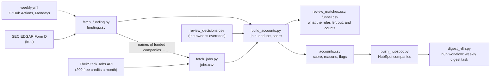

# Signal Pipeline

A small go-to-market pipeline that answers one question every week: **which SF Bay Area AI startups should a recruiting platform contact now, and why?**

It joins two public signals, open AI engineering roles and recent funding, scores each company, explains every score, and decides uncertain matches by written rules that flag their own doubts, so no run waits for a person. It runs on free tiers only.

The worked example is a platform such as [Brix](https://www.joinbrix.com), which places forward deployed and applied AI engineers. Its best prospects are companies that are hiring those roles this week.

## Results

Measured on 2026-11-16, with the review decisions of 2026-11-17. Every number comes from a real run.

| Step | Result |
|---|---|
| Funding: SEC Form D notices by California issuers, last 90 days | 1,364 new notices (651 amendments skipped) |
| ...with a Bay Area ZIP code and an industry that is not a fund or property | 251 filings from 231 companies |
| ...inside the amount rule ($100,000 to under $200 million sold) | 197 filings from 184 companies |
| Hiring: Bay Area companies with a forward deployed or applied AI engineer opening, last 14 days | 72 companies beyond the 14 already found (108 postings) |
| Job records fetched | 60, which are 54 distinct postings at 40 companies |
| Dropped by the rules | 3 companies with no usable Form D filing and no core role |
| On the owner's block list | 3: two competitors (a firm that sells engineering teams and an AI headhunter) and a fertility clinic |
| Waiting for a person | 0: rules decide every uncertain match; 7 accounts carry a flag |
| **Accounts** | **34**: 8 funded and hiring, 26 hiring only; 23 have a forward deployed opening |
| HubSpot, first live test (2026-11-17) | 5 companies created; a second run created none and updated 5 |
| Digest in n8n, first live run (2026-11-18 UTC) | the workflow found the 5 new companies and created 1 HubSpot task, in 9 seconds |
| Weekly workflow on GitHub, first run (2026-11-18 UTC, started by hand, capped at 1 + 1 credits) | every step passed in 13.5 minutes: 1,347 filings read, 2 credits spent, 2 accounts, 1 company created and 1 updated in HubSpot, 1 digest task |
| Contact lookup through Hunter, test on 5 companies of 4 to 489 people (2026-11-18 UTC) | the target role for 1, the right team but not its lead for 2, nothing for 2: Hunter holds no address for those two domains, even in a wide search. All 3 emails valid by Hunter's own check. 6 of 50 free credits over two rounds |
| Apollo draft sequence (2026-11-18 UTC) | 1 inactive sequence created through the API on the free plan: 3 steps, every email waiting for review. No contact added, nothing sent |
| Cost | $0: 60 of TheirStack's 200 free monthly credits; SEC is free |
| Offline checks | 511, in 8 files, on simulated data |

The first version listed 5 companies. It required a Form D filing, and only 9 of the 184 funded companies (5%) had a matching job. A backtest explained why: of 5 AI startups that Brix names as customers, only one had filed a Form D under its own name since 2023. Funding now adds points instead of deciding who is listed, and the list grew to 28, with 7 more companies waiting for review.

A reviewer first decided those cases one by one. On 2026-11-17 rules replaced that step, so the weekly run no longer waits for anyone, and the list is now 34. Replayed with no hand decisions, the rules reproduce 6 of the reviewer's 9 decisions: two competitors and a fertility clinic are caught only by the block list, and one staffing firm that the rules drop was kept by hand. One gap stays visible: the search filters on where a company is based, not on where the job is, so for 11 of the 34 accounts the only posting fetched is remote, outside the Bay Area or names no city.

## How it works



1. **`fetch_funding.py`** reads every new Form D notice by a California issuer and flags Bay Area ZIP codes, excluded industries and a stage estimate from the amount sold.
2. **`fetch_jobs.py`** searches TheirStack twice: jobs at the funded companies, by name, and new companies hiring for a core role, one job per company so each credit buys one company.
3. **`build_accounts.py`** joins the two by cleaned company name, merges copies of the same posting, decides uncertain matches by rule, scores each company, writes the reason for every point and a funnel table of where each company went.
4. **`push_hubspot.py`** creates or updates each company in HubSpot, searching by domain first so a second run creates nothing.
5. **`digest_n8n.py`** runs an [n8n](https://n8n.io) workflow, `automation/n8n/weekly_digest.json`, in a throwaway Docker container: it reads the week's new companies from HubSpot and creates one task that lists them with their flags. It is how the owner sees what the rules listed.
6. **`.github/workflows/weekly.yml`** runs these steps every Monday with a fixed credit cap and writes a run summary.

### Scoring

| Signal | Points |
|---|---|
| First sale of a Form D round up to 30, 60 or 90 days ago | +3, +2, +1 |
| No Form D filing found | +0 |
| Relevant open roles (distinct titles, not postings) | +1 each, at most +3 |
| A forward deployed engineer opening | +1 |
| Mandarin-speaking founder or technical lead, confirmed by hand | +2 |

The last signal is specific to the example customer, which serves bilingual teams. It is filled in only by hand, from public evidence such as Chinese-language press or the person's own profile, and is never inferred from a name. No account has it yet.

An account row looks like this (SIMULATED example; real output stays out of the repo, see Limits):

| company_name | signal_tier | role_titles | score | score_reason |
|---|---|---|---|---|
| Example Robotics | funded_and_hiring | Forward Deployed Engineer; ML Engineer | 6 | first sale 2026-10-29, 18 days before 2026-11-16: +3; 2 relevant role title(s): +2; FDE opening: +1; no Mandarin-lead evidence: +0 |

### Rules instead of a review queue

No run waits for a person. Each uncertain case has a rule, and the doubt is written in the account's `flags` column:

- A job matched on a short form of the legal name ("Generalist" for "Generalist AI, Inc.") counts only when a longer spelling of the legal name is the company's domain, job board name or LinkedIn page name, or appears in its description. Otherwise the filing is not used.
- A name that fits several Form D issuers, or an issuer that fits several companies, is not used.
- For a confirmed match the Form D address places the HQ, even when TheirStack says otherwise.
- A filing above the amount rule adds a flag instead of stopping the company.
- A description that suggests a staffing or services firm adds a flag. The firm is dropped only when its 30-day postings exceed 5 times its headcount, which means it posts jobs for other companies.
- A company with no usable filing needs a core role and a Bay Area HQ.

`review_matches.csv` lists every company the rules left out and every filing they did not use, with the reason; `funnel.csv` counts where each company went, and the run fails if the parts do not add up. The owner can override any rule in one hand-edited file: an accept keeps a company or confirms a match, a reject puts a company on the block list, which also keeps it out of the job search so it stops costing credits.

## Guardrails

- **Credits.** TheirStack charges one credit per job returned. Every response is cached before use, jobs already received are excluded from each request, a count for one credit comes before any larger fetch, and `--limit` caps every run.
- **No scraping, no sending.** Data comes from documented APIs. The pipeline drafts and scores and never sends; outreach goes out only from a sequencing tool, in the owner's name, after the owner approves the batch.
- **No personal data in the repo.** `find_contacts.py` can look up one contact per account through Hunter's API. It refuses to run unless git ignores its output, discards the people it does not pick, saves no phone numbers or social profiles, and logs counts only. The repo holds company-level data only, and generated tables are git-ignored.
- **Outreach tooling cannot send.** `apollo_sequence.py` knows two Apollo endpoints: list schedules and create a sequence. It creates the sequence inactive with every email waiting for review, and has no code to add contacts, approve an email or activate anything.
- **Secrets** live in `.env` and in GitHub Secrets, never in code, logs or cached responses.

## How it was built

I set the rules, approved each step's plan, reviewed every output and made the review decisions. [Claude Code](https://claude.com/claude-code) wrote the code under those rules, which are in [CLAUDE.md](CLAUDE.md). Because I did not write the code by hand, each script has offline checks on simulated data, and I had bugs planted on purpose to confirm the checks catch them. The trade-offs behind each choice are in [DECISIONS.md](DECISIONS.md).

## Run it

```bash
python -m venv .venv && .venv/bin/pip install -r requirements.txt
cp .env.example .env          # add your TheirStack key and an SEC User-Agent
python tests/run_all.py       # 511 offline checks, no API calls (one file needs Node.js)

python fetch_funding.py                                                    # free; about 12 minutes the first time
python fetch_jobs.py --funded-companies --any-hq-city --days 30 --limit 1  # 1 credit: counts the matches
python fetch_jobs.py --core-roles --one-per-company --days 14 --limit 1    # 1 credit: counts hiring companies
python build_accounts.py
python push_hubspot.py --dry-run                                           # prints the plan, sends nothing
python digest_n8n.py --dry-run                                             # prints the docker command, runs nothing
```

Add `--dry-run` to `fetch_jobs.py` to print a request without spending a credit.

## Limits and what I would change

- **Form D misses many rounds.** It is free and official, but 4 of 5 known customers had no filing under their own name. With a budget I would add a funding source that has round names.
- **Hiring-only accounts were fetched one job per company**, so their role count is a lower bound and most of them score 1 or 2. Ranking inside that tier still needs a person.
- **"Bay Area" means the company's HQ, not the job's location.** For 11 of the 34 accounts the only posting fetched is remote, outside the Bay Area or names no city. They stay on the list because the company is based here, and `job_locations` shows where each role is. A list of local roles only would need a job-location filter in the search.
- **Name matching is brittle.** Form D has legal names, TheirStack has brand names. A short-form match counts only when a second field confirms it; a brand that shares nothing with the legal name is missed.
- **Rules can be wrong, and nothing stops them.** A company that is not a customer stays listed until the owner adds it to the block list: of the first 40 companies, one (a fertility clinic) got through every rule. The funnel table and the `flags` column are there so that this is visible.
- **TheirStack lists one posting found on a careers page and on Indeed as two jobs** and charges for both. The pipeline merges them afterwards.
- **Generated tables stay out of the repo** until TheirStack's terms on sharing its data are confirmed, so this page shows totals.

## Status

- Done and run on real data: steps 1 to 3.
- Step 4 ran live on 2026-11-17 for the first 5 accounts: 7 company properties and 5 companies created; a second run created none and updated 5.
- The weekly workflow ran once on GitHub, started by hand with a cap of 1 + 1 credits, and every step passed. The Monday schedule is switched off until its weekly credit cap is approved. GitHub keeps its own data between runs, so that run built its 2 accounts from scratch; the 34 above come from the runs on my own machine.
- Next: push the other accounts, the first scheduled run, screenshots, and a Clay version of the same table for comparison.
- The n8n digest ran twice: once from my machine and once inside the weekly workflow on GitHub.
- `find_contacts.py` ran on 5 companies, in two rounds. Widening the search did not help the 2 companies Hunter has no address for, so a second source is the next thing to test. Names and emails stay on my machine.
- `apollo_sequence.py` ran once: Apollo holds one inactive draft sequence with three emails waiting for review. No mailbox is linked, no contact was added and nothing has been sent to anyone. No send is planned: the sequence stays a draft ([guide](docs/apollo-sequence.md)).

## Repo map

| Path | What it is |
|---|---|
| `fetch_funding.py`, `fetch_jobs.py`, `build_accounts.py`, `push_hubspot.py` | The four steps |
| `digest_n8n.py`, `automation/n8n/weekly_digest.json` | The weekly digest: an n8n workflow and the script that runs it headless |
| `find_contacts.py` | Optional: looks up one contact per account through Hunter's API, the code version of a Clay enrichment column; names and emails stay in git-ignored files |
| `apollo_sequence.py`, `automation/apollo/project2_sequence.json` | Creates one inactive draft email sequence in Apollo from three draft emails |
| `names.py`, `bay_area.py` | Company-name cleaning and Bay Area rules shared by the steps |
| `tests/` | Offline checks; `python tests/run_all.py` runs them all |
| `.github/workflows/weekly.yml` | The Monday run |
| `CLAUDE.md` | The spec and the rules the AI agent works under |
| `DECISIONS.md` | Each design choice and its trade-off |
| `docs/clay-table.md` | A guide for building the same table in Clay |
| `docs/make-digest.md` | Not used: the same digest built by hand in Make |
| `docs/apollo-sequence.md` | A guide for a small, owner-approved email sequence in Apollo |
