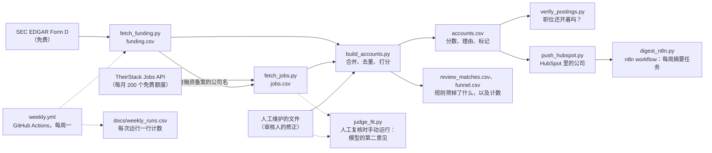

# Signal Pipeline

[English](README.md) | **中文**

一条每周运行的流水线，告诉一家招聘平台：旧金山湾区哪些 AI 创业公司现在值得联系，以及为什么。它把招聘和融资两类信号合在一起，给每家公司打分并写明理由，再把名单同步到 HubSpot，全程只用各家 API 的免费额度。

我做这个项目，是为了在一个真实问题上把 GTM engineering 的工具链用一遍、学一遍。示例客户是 [Brix](https://www.joinbrix.com) 这样的平台：它为客户招 forward deployed 和 applied AI 工程师，所以它最好的潜在客户，就是这一周正在招这些职位的公司。

这是我的个人作品集项目。我不代表 Brix 或任何其他公司，也没有向任何人发过邮件或消息。

## 我做了什么

下表每一行是 GTM engineer 工作里的一块：我在这个项目里做了什么、用了什么工具、实测结果是什么。

| 要做的事 | 我做了什么，用了什么工具 | 结果 |
|---|---|---|
| 定下找谁，并检验这个定义 | 把目标客户写成规则：总部在湾区，正在招 forward deployed 或 applied AI 工程师，近期有 SEC 融资备案的加分。再拿示例客户公开列出的客户回头检验这套规则 | 第一版规则只找到 5 家。检验说明了原因：5 家已知客户里有 4 家没有用自己的名字做过融资备案。改正后的规则列出 34 家 |
| 用 API 拿数据，并控制花费 | 招聘数据来自 TheirStack Jobs API，融资数据来自 SEC EDGAR Form D。每次要花钱的运行都先拿几条试、设上限，并把结果存下来，同样的数据不付两次钱 | 读了 1,364 份融资备案和 60 条职位记录。每月 200 个免费额度用了 62 个 |
| 清洗、匹配、打分 | 把备案里的法定公司名和职位数据里的品牌名对上，把同一个职位的重复记录合并，给每家公司打分并写明每一分的理由。拿不准的情况由书面规则决定，并把疑点标出来 | 34 家目标客户，其中 8 家带标记。没有一次运行需要等人 |
| 写进 CRM | 通过 HubSpot 的 API 新建和更新公司，写入前先按域名查找 | 34 家全部写入。再跑一次，新建的重复公司是 0 家 |
| 让它每周自动跑 | GitHub Actions 每周一把所有步骤跑一遍。随后一个 n8n workflow 把这一周新增的客户写进一条 HubSpot 任务 | 在 GitHub 上完整跑通 2 次，并已设成每周一自动运行。每次运行都会在 [docs/weekly_runs.csv](docs/weekly_runs.csv) 里加一行计数 |
| 让名单保持新鲜 | 向三家招聘网站（Ashby、Greenhouse、Lever）的公开接口查询每个职位是否还挂着 | 核对了 18 个职位：16 个还开着，1 个换了链接重新发布，1 个已关闭 |
| 找到该联系的人 | 用 Hunter 的 API 给每家公司查一个联系人。然后在 Clay 里手动操作，对 Hunter 没找到对口职位的 10 家公司，跑了它的找人功能和邮箱 waterfall（一个数据源查不到就换下一个） | Hunter：34 家里 29 家查到邮箱，其中 15 家是对口职位。在那 10 家上，Clay 给 7 家查到了对口职位的邮箱 |
| 准备好外联，但不发送 | 通过 Apollo 的 API 建了一个邮件序列草稿。它是停用的，每封邮件都在等人工审核 | 1 个草稿序列，3 封邮件。没有发出任何东西 |
| 用 AI，并核对它写的东西 | 模型起草每家客户"为什么现在联系"的那句话，并对"这家公司到底是不是目标客户"给出第二意见。脚本拿数据核对它写的文字，拿我的决定核对它的判断 | 34 句话里，数据不支持的事实是 0 处。模型和我的 9 个决定全部一致；只靠规则能对上 6 个 |
| 证明它是对的 | 每个脚本都有离线检查。再一次埋一个小 bug，证明这些检查真的能发现问题 | 714 条离线检查，分布在 13 个文件。201 个故意埋的 bug，全部被发现 |

我和 AI 编程工具是怎么分工的，见下文[怎么做出来的](#怎么做出来的以及-ai-用在哪里)一节。

**这个项目说明不了什么。** 没有联系过任何人，所以名单背后没有回复率、没有会议，也没有收入。数据只覆盖一周。它能衡量的只有自己的数据：名单上有多少家、职位新不新、找到了多少联系人。

**如果你不读代码**，可以看[每周运行记录](docs/weekly_runs.csv)（每次运行一行计数）、[输出样例](docs/sample_output/)和[每个决定及其取舍](DECISIONS.md)。后两个是英文的。

## 全部数字

实测时间是 2026-11-16 到 2026-11-18。每个数字都来自真实的运行。

| 步骤 | 结果 |
|---|---|
| 融资：加州公司最近 90 天的 SEC Form D 备案 | 1,364 份新备案（另有 651 份修订备案不计） |
| ……其中邮编在湾区、行业不是基金或房地产的 | 251 份备案，来自 231 家公司 |
| ……其中金额在规则范围内的（已售出 $100,000 以上、$200 million 以下） | 197 份备案，来自 184 家公司 |
| 招聘：最近 14 天有 forward deployed 或 applied AI 工程师职位的湾区公司 | 除已找到的 14 家外，还有 72 家（108 个职位） |
| 拿到的职位记录 | 60 条，去重后是 40 家公司的 54 个职位 |
| 被规则筛掉 | 3 家：既没有可用的 Form D 备案，也没有核心职位 |
| 在审核人的排除名单上 | 3 家：两家竞争对手（一家外派工程团队的公司、一家 AI 猎头）和一家生育诊所 |
| 等人处理 | 0 家：每个拿不准的匹配都由规则决定；8 家带标记 |
| **目标客户** | **34** 家：8 家有融资备案且在招，26 家只在招；23 家有 forward deployed 职位 |
| 名单背后的在招职位 | 45 个职位，其中 25 个是 forward deployed；28 个写了薪资，薪资区间中点的中位数是 $195,000。每家新公司只拿了一个职位，所以这是下限 |
| 这些职位还开着吗？（2026-11-18） | 45 个里有 18 个在有公开接口的招聘网站上，分属 10 家客户：16 个开着，1 个换链接重发，1 个已关闭。其余 27 个在 LinkedIn 或别的网站上，没有核对 |
| HubSpot（2026-11-17 和 2026-11-18） | 第一次测试：新建 5 家。全量：新建 29 家、更新 5 家；再跑一次，没有新建，更新 34 家 |
| n8n 摘要（2026-11-18 UTC） | 第一次运行：workflow 找到 5 家新公司，建了 1 条 HubSpot 任务，用时 9 秒。全量写入后：35 家新客户，8 家带标记，1 条任务 |
| GitHub 上的每周 workflow，第一次运行（2026-11-18 UTC，手动启动，上限 1 + 1 个额度） | 每一步都通过，用时约 13.5 分钟：读了 1,347 份备案，花了 2 个额度，得到 2 家客户，HubSpot 新建 1 家、更新 1 家，建了 1 条摘要任务。之后每次运行见 [docs/weekly_runs.csv](docs/weekly_runs.csv) |
| 用 Hunter 查联系人的覆盖率，全部 34 家（2026-11-18 UTC） | 29 家查到邮箱（85%）：15 家是对口职位（44%），5 家是对口团队但不是负责人，9 家是其他职位。5 家什么都没有：Hunter 没有这些域名的地址。按 Hunter 自己的验证，29 个邮箱里 26 个有效，2 个是 accept-all，1 个未评级 |
| 同样的查找，在 Clay 里手动做，对象是 Hunter 没找到对口职位的 10 家（2026-11-18 UTC） | Clay 的找人功能在这 10 家里的 8 家找到 25 个人，其中 7 家有对口职位。它的邮箱 waterfall 依次尝试 11 个数据源，给这 7 个人全部查到了工作邮箱。同样这 10 家，Hunter 的结果是：5 家只有其他职位，5 家什么都没有。Clay 之外没有保存任何人名或邮箱 |
| Apollo 邮件序列草稿（2026-11-18 UTC） | 在免费版上通过 API 建了 1 个停用的序列：3 步，每封邮件都在等审核。没有加任何联系人，没有发出任何东西 |
| 模型对"是不是目标客户"的第二意见（2026-11-18 UTC） | 模型在看不到公司名的情况下读了全部 40 家公司的资料：35 家是目标客户，3 家不是，2 家拿不准。它和审核人的 9 个决定全部一致，而只靠规则能对上 6 个；它引用的每一句原话都能在发给它的资料里找到。它的判断标准是根据这些决定的理由写的，所以这说明的是模型能照着写明的标准判断，不说明这套标准本身经过了验证 |
| 花费 | 数据：$0，TheirStack 每月 200 个免费额度用了 62 个，Hunter 的 50 个用了 32 个；SEC 和招聘网站的接口免费。模型判断这一步：40 家公司按标价共 $0.96。Clay：免费试用的 1,000 个额度用了 11.7 个 |
| 离线检查 | 714 条离线检查，分布在 13 个文件，都用模拟数据。201 个故意埋的 bug，每个都被检查发现 |

第一版只列出 5 家公司。它要求公司必须有 Form D 备案，而 184 家有备案的公司里只有 9 家（5%）对得上职位。回测解释了原因：Brix 公开列出的 5 家 AI 创业公司客户里，2023 年以来用自己的名字做过 Form D 备案的只有 1 家。所以融资现在只加分，不再决定谁上名单；名单随之增加到 28 家，另有 7 家等人工审核。

起初这些情况由审核人（在本项目里就是我）逐个决定。2026-11-17 起改由规则决定，每周的运行不再等任何人，名单现在是 34 家。不带人工决定、只让规则重跑一遍，能复现审核人 9 个决定里的 6 个。漏掉的 3 个是：没有排除名单的话，一家外派工程团队的竞争对手和一家生育诊所会留在名单上；一家审核人留下的外包公司会被筛掉。让模型去读每家公司的简介，9 个决定它全部一致；但模型只提意见，名单仍由规则和审核人决定。还有一个缺口摆在明面上：搜索按公司总部所在地筛选，不按职位所在地，所以 34 家里有 11 家，拿到的唯一职位是远程、在湾区以外或没写城市。

## 它是怎么工作的



1. **`fetch_funding.py`** 读取加州公司每一份新的 Form D 备案，标出湾区邮编、要排除的行业，并按售出金额粗估融资阶段。
2. **`fetch_jobs.py`** 在 TheirStack 上搜两次：一次按公司名找有融资备案的公司的职位；一次找正在招核心职位的新公司，每家只拿一个职位，这样一个额度换一家公司。
3. **`build_accounts.py`** 按清洗后的公司名把两边合并，合并同一职位的重复记录，用规则决定拿不准的匹配，给每家公司打分，写明每一分的理由，并输出一张漏斗表，说明每家公司去了哪里。
4. **`verify_postings.py`** 向有公开接口的招聘网站（Ashby、Greenhouse、Lever）查询每个职位是否还挂着：开着、换链接重发，或已关闭。LinkedIn 的链接从不抓取。
5. **`push_hubspot.py`** 在 HubSpot 里新建或更新每家公司，先按域名查找，所以再跑一次不会新建任何东西。
6. **`digest_n8n.py`** 在一个用完即弃的 Docker 容器里运行一个 [n8n](https://n8n.io) workflow（`automation/n8n/weekly_digest.json`）：它从 HubSpot 读出这一周新增的公司，建一条任务，把它们连同标记列出来。审核人就是靠它看到规则列出了什么。
7. **`.github/workflows/weekly.yml`** 每周一按固定的额度上限运行这些步骤，往 [docs/weekly_runs.csv](docs/weekly_runs.csv) 里加一行计数，并写一份运行摘要。

有三个脚本只在人工复核时手动运行，每周任务从不运行它们：**`judge_fit.py`** 让模型判断每家公司到底是不是目标客户，**`find_contacts.py`** 给每家客户查一个联系人，**`apollo_sequence.py`** 建那个邮件序列草稿。

### 打分

| 信号 | 分数 |
|---|---|
| Form D 这一轮的首次售出日在 30、60 或 90 天以内 | +3、+2、+1 |
| 没找到 Form D 备案 | +0 |
| 相关的在招职位（按不同的职位名算，不按发帖数算） | 每个 +1，最多 +3 |
| 有 forward deployed engineer 职位 | +1 |
| 一个因客户而异的信号，由人工确认 | +2 |

最后一个信号留给某个客户在招聘和融资之外特别看重的东西。它只能由人工填写，证据写在旁边，绝不靠推断。目前没有任何一家公司有这一项。

名单里的一行是这样的（这是模拟数据；[docs/sample_output/](docs/sample_output/) 里还有五行，真实输出不放进仓库，见"局限"一节）：

| company_name | signal_tier | role_titles | score | score_reason |
|---|---|---|---|---|
| Example Robotics | funded_and_hiring | Forward Deployed Engineer; ML Engineer | 6 | first sale 2026-10-29, 18 days before 2026-11-16: +3; 2 relevant role title(s): +2; FDE opening: +1; no client-specific bonus evidence: +0 |

### 用规则代替排队等人审核

没有一次运行需要等人。每种拿不准的情况都有一条规则，疑点写在这家公司的 `flags` 一栏里：

- 职位是按法定名称的简称匹配上的（比如用"Generalist"匹配"Generalist AI, Inc."），只有当法定名称的更长写法出现在公司的域名、招聘网站上的名字、LinkedIn 页面名或简介里时才算数。否则这份备案不用。
- 一个名字对得上好几家 Form D 备案公司，或者一家备案公司对得上好几家公司，这样的匹配不用。
- 匹配确认后，总部所在地以 Form D 上的地址为准，即使 TheirStack 的说法不同。
- 备案金额超过规则上限时，加一个标记，而不是把公司拦下。
- 简介看起来像外包或服务类公司时，加一个标记。只有当它 30 天内的发帖数超过员工数的 5 倍时才剔除，因为这说明它在替别的公司发职位。
- 没有可用备案的公司，必须有核心职位，并且总部在湾区。

`review_matches.csv` 列出规则筛掉的每一家公司和没有采用的每一份备案，并写明原因；`funnel.csv` 统计每家公司去了哪里，各部分加起来对不上，运行就会报错。审核人可以在人工维护的文件里推翻规则：accept 是留下一家公司或确认一个匹配；reject 是把公司放进排除名单，同时让它不再出现在职位搜索里，不再花额度；更正网址则是替换掉 TheirStack 给错的网址。每一处人工修改，都会在被修改的那一行标明。

## 防护措施

- **额度。** TheirStack 每返回一条职位收一个额度。每个返回都先存下来再用；每次请求都排除已经拿过的职位；大批量拿数据之前，先花一个额度问清数量；每次运行都有 `--limit` 上限。
- **不抓取，不发送。** 数据都来自有文档的 API。流水线只起草和打分，从不发送；外联只能从发信工具里发出，以发件人自己的名义，并且要本人批准每一批。Clay 的测试用的是 Clay 自己的人员数据和邮箱数据源，手动操作；没有抓取任何 LinkedIn 页面。
- **仓库里没有个人数据。** `find_contacts.py` 可以通过 Hunter 的 API 给每家客户查一个联系人。如果 git 没有忽略它的输出文件，它就拒绝运行；没选中的人会被丢弃；不保存电话和社交账号；日志里只有计数。衡量覆盖率时用的是 `--outcomes-only` 模式，这个模式完全不写入任何姓名、邮箱或职位。仓库里只有公司层面的数据，生成的表格都被 git 忽略。
- **外联工具发不出信。** `apollo_sequence.py` 只认识 Apollo 的两个接口：列出日程表和新建序列。它建的序列是停用的，每封邮件都在等审核；代码里没有添加联系人、批准邮件或启用任何东西的功能。
- **密钥**只放在 `.env` 和 GitHub Secrets 里，从不出现在代码、日志或缓存的返回里。

## 怎么做出来的以及 AI 用在哪里

规则是我定的，每一步的方案是我批准的，每一份输出是我验收的，人工审核的决定也是我做的。代码由 [Claude Code](https://claude.com/claude-code) 在这些规则下编写，规则写在 [CLAUDE.md](CLAUDE.md) 里。每个选择背后的取舍见 [DECISIONS.md](DECISIONS.md)。

正因为代码不是我手写的，这里没有任何东西是靠"相信"成立的：

- **离线检查。** 每个脚本都有一个检查文件，用模拟数据运行它，不调用任何 API。
- **故意埋的 bug。** [`tests/planted_bugs.py`](tests/planted_bugs.py) 在脚本和 workflow 的副本里一次埋一个小 bug（关掉一道防护、把边界挪一位、把密钥写到不该写的地方），确认检查能把每一个都发现。
- **模型只写一类文字，并且有脚本核对。** 每家客户"为什么现在联系"的那句话，是人工复核时由模型按[书面规则](prompts/why_now_rules.md)起草的。[`why_now_check.py`](why_now_check.py) 再拿这家公司自己的数据，核对句子里的每个日期、金额和数量。34 句真实的句子里它发现 0 个问题；在这些句子的副本里故意写错的 11 处，它全部拦下。
- **模型给第二意见，这个意见要被打分。** 规则读不懂简介：它们把客户的一家竞争对手和一家生育诊所列进了名单。[`judge_fit.py`](judge_fit.py) 把每家公司的资料按[书面的判断标准](prompts/fit_rules.md)发给 Claude API，公司名和网址先遮掉，拿回一个判断、依据的规则和一句引用的原话。脚本先核对这句原话在不在它发出去的资料里，再把判断和审核人的决定比较：9 个里 9 个一致。模型的回答从不改动名单；它拿不准的两家仍在名单上，并加了说明。
- **每周任务不调用任何模型。** 它不花钱，同样的数据得到同样的名单。
- **两种语言，一套数字。** 有一条检查会比较本页和英文版每一张表里的数字，不一致就报错。

## 运行方法

```bash
python -m venv .venv && .venv/bin/pip install -r requirements.txt
cp .env.example .env          # 填入你的 TheirStack key 和 SEC User-Agent
python tests/run_all.py       # 全部离线检查，不调用任何 API（其中一个文件需要 Node.js）
python tests/planted_bugs.py  # 可选，约 10 分钟：每个故意埋的 bug 都必须被发现

python fetch_funding.py                                                    # 免费；第一次约 12 分钟
python fetch_jobs.py --funded-companies --any-hq-city --days 30 --limit 1  # 1 个额度：数一数有多少匹配
python fetch_jobs.py --core-roles --one-per-company --days 14 --limit 1    # 1 个额度：数一数有多少公司在招
python build_accounts.py
python verify_postings.py --dry-run                                        # 数一数要查询几家招聘网站
python push_hubspot.py --dry-run                                           # 只打印计划，不发送
python digest_n8n.py --dry-run                                             # 只打印 docker 命令，不运行
python judge_fit.py --dry-run                                              # 数一数要发给模型几个请求，不发送
```

给 `fetch_jobs.py` 加上 `--dry-run`，可以只打印请求而不花额度。

## 局限，以及我会怎么改

- **这里没有任何东西是拿收入衡量的。** 没有发过邮件，所以名单没有回复率，也没有 pipeline 金额。下一步的检验应该是真实的：请销售团队给这些客户打分，再按打分调整信号。
- **Form D 漏掉了很多轮融资。** 它免费而且是官方数据，但 5 家已知客户里有 4 家没有用自己的名字备案。有预算的话，我会加一个带轮次名称的融资数据源。
- **只在招的公司，每家只拿了一个职位**，所以它们的职位数是下限，大多数得 1 分或 2 分。这一层内部怎么排序，仍然需要人来判断。
- **"湾区"指公司总部，不指职位所在地。** 34 家里有 11 家，拿到的唯一职位是远程、在湾区以外或没写城市。它们留在名单上是因为公司总部在这里，`job_locations` 一栏写明了每个职位在哪。如果只想要本地职位，需要在搜索里加职位所在地的筛选。
- **45 个职位里只有 18 个能用代码复查。** 其余是 LinkedIn 链接，本项目不抓取，只能人工点开看。"已关闭"的意思是这个职位不在招聘网站公开的列表里了。
- **代码里只有一个联系人数据源。** 34 个域名里，Hunter 有 5 个完全没有地址，另有 14 家找到的不是该联系的那个人。Clay 的测试在最难的 10 家里给 7 家找到了对口的人的邮箱，所以第二个数据源值得加。但代码里还没有做：Clay 的列要在浏览器里手动设置。
- **名称匹配很脆弱。** Form D 里是法定名称，TheirStack 里是品牌名。简称匹配只有在第二个字段确认时才算数；品牌名和法定名称毫无共同之处的公司会被漏掉。
- **规则会出错，而且没有东西能拦住它。** 不是客户的公司会一直留在名单上，直到审核人把它加进排除名单：前 40 家公司里，有两家（一家竞争对手和一家生育诊所）通过了所有规则。漏斗表和 `flags` 一栏的作用就是让这种情况看得见。`judge_fit.py` 能把这两家都标出来，但前提是有人去运行它。
- **模型判断这一步，目前能证明的还很少。** 它只在 9 个决定上打过分，其中拒绝的只有 3 个，只跑了一次，而且判断标准正是根据这些决定的理由写的。真正的检验需要它没见过的答案：销售团队的打分，或者审核人对下个月新公司的决定。
- **同一个职位如果既在公司官网又在 Indeed 上，TheirStack 会算成两条**，两条都收费。流水线事后再把它们合并。
- **生成的表格不放进仓库**，要等确认 TheirStack 对数据分享的条款之后再说。所以本页只给出总数，`docs/sample_output/` 里的样例是模拟的。

## 进展

- 第 1 到 3 步在真实数据上跑过；34 家的名单来自我自己电脑上的运行。
- 34 家全部在 HubSpot 里，再推一次没有产生重复。
- 每周 workflow 于 2026-11-18 在 GitHub 上跑了两次，都是手动启动、上限 1 + 1 个额度，两次每一步都通过。周一的定时已经打开，每次上限 10 + 10 个额度，每次运行都会往 [docs/weekly_runs.csv](docs/weekly_runs.csv) 里加一行。GitHub 上的数据是它自己逐次累积的，所以它的名单从第一次运行的 2 家开始，每周找到多少就增加多少。
- n8n 摘要跑了四次：两次在我的电脑上，两次在每周 workflow 里。
- `find_contacts.py` 在全部 34 家上衡量了联系人覆盖率。这次衡量没有保存任何姓名、邮箱或职位；第一次测试的 5 家公司各有一个联系人，留在我的电脑上。Clay 测试里的人名和邮箱只存在于我的 Clay 工作区里。
- `apollo_sequence.py` 运行过一次：Apollo 里有一个停用的序列草稿，三封邮件在等审核。没有连接邮箱，没有添加联系人，没有向任何人发过任何东西。也不打算发：这个序列会一直是草稿。
- `judge_fit.py` 在全部 40 家公司上运行过一次。它的回答保存在我的电脑上；它拿不准的两家（一家做药物研发的公司，和一家简介里没说自己卖什么的公司）仍在名单上，并加了说明。
- 接下来：截图、在代码里加第二个联系人数据源、请销售团队打分来调整信号。

## 文件说明

| 路径 | 是什么 |
|---|---|
| `fetch_funding.py`、`fetch_jobs.py`、`build_accounts.py`、`push_hubspot.py` | 四个主要步骤 |
| `verify_postings.py` | 通过三家招聘网站的公开接口，核对每个职位是否还开着 |
| `digest_n8n.py`、`automation/n8n/weekly_digest.json` | 每周摘要：一个 n8n workflow，以及不开界面运行它的脚本 |
| `weekly_row.py`、`docs/weekly_runs.csv` | 每次每周运行的一行计数，由 workflow 提交 |
| `find_contacts.py` | 可选：通过 Hunter 的 API 给每家客户查一个联系人，相当于 Clay 里一个 enrichment 列的代码版；姓名和邮箱只留在被 git 忽略的文件里 |
| `apollo_sequence.py`、`automation/apollo/outreach_sequence.json` | 用三封邮件草稿在 Apollo 里建一个停用的邮件序列草稿 |
| `why_now_check.py`、`prompts/why_now_rules.md` | 模型起草"为什么现在联系"那句话时遵守的规则，以及拿数据逐句核对的脚本 |
| `judge_fit.py`、`prompts/fit_rules.md` | 可选，手动运行：让 Claude API 判断每家公司是不是目标客户（公司名先遮掉），并拿审核人的决定给回答打分 |
| `names.py`、`bay_area.py` | 各步骤共用的公司名清洗和湾区规则 |
| `tests/` | 离线检查（`python tests/run_all.py`）和故意埋的 bug（`python tests/planted_bugs.py`） |
| `docs/sample_output/` | 真实运行的漏斗计数，以及一份模拟的名单样例 |
| `.github/workflows/weekly.yml` | 每周一的运行 |
| `README.md` | 本页的英文版 |
| `CLAUDE.md` | 需求说明，以及编程工具要遵守的规则 |
| `DECISIONS.md` | 每个设计选择及其取舍 |
